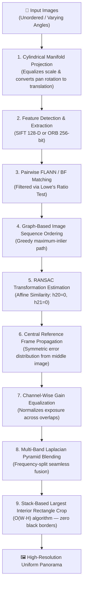

# 🔭 Panorama Reconstruction & Image Stitching System

<div align="center">

[](https://www.python.org/)
[](https://opencv.org/)
[](https://streamlit.io/)
[](https://numpy.org/)
[](LICENSE)
[]()

**An advanced Computer Vision system that aligns and stitches unordered overlapping photographs into high-resolution, seamless panoramas with mathematically guaranteed uniform height and zero wedge distortion.**

</div>

---

## 📌 Executive Summary

Panoramic image stitching is often compromised by two classical failure modes:
1. **Wedge / Trumpet Distortion**: In naive sequential planar homography stitching, projective division terms ($h_{20}, h_{21}$) compound multiplicatively from left to right, flaring the canvas outward into a distorted cone with ragged black boundaries.
2. **Exposure & Seam Discontinuities**: Variable camera auto-exposure and lighting shifts produce visible vertical bands and luminance boundaries across image joints.

This repository implements a **multi-stage computer vision reconstruction pipeline** engineered to solve these exact problems. By combining **cylindrical manifold projection**, **RANSAC-constrained Affine similarity estimation**, **central reference frame propagation**, **channel-wise gain compensation**, and **multi-band Laplacian pyramid blending**, the system produces distortion-free, uniformly illuminated panoramas.

---

## 🌟 Key Technical Innovations



### 1. Zero Wedge / Flare Distortion
- **The Problem**: Chained 3×3 projective homographies accumulate projective scale errors ($h_{20}, h_{21} \neq 0$). The right side of the canvas balloons upwards and downwards into a wedge.
- **The Solution**: 
  - **Cylindrical Projection**: Maps camera rotations around the vertical axis into pure horizontal translations ($x = f \cdot \tan\theta$, $y = Y / \cos\theta$).
  - **Affine Similarity Model**: Constrains transformation to 4 degrees of freedom (rotation, uniform scale, translation $t_x, t_y$), strictly enforcing $h_{20}=0, h_{21}=0$. Height remains 100% constant across the entire stitched canvas.

### 2. Central Reference Frame Alignment
- Rather than sequentially compounding errors from frame $0 \to N-1$, the pipeline automatically designates the **median image** ($k_{ref} = \lfloor N/2 \rfloor$) as the global origin.
- Transforms propagate symmetrically outward to the left and right. This halves the maximum transformation chain length ($N/2$ instead of $N-1$), minimizing cumulative blur and alignment drift.

### 3. Channel-Wise Gain / Exposure Compensation
- Computes mean color luminance per channel ($B, G, R$) across overlapping image masks.
- Outwardly equalizes relative gain ratios ($g_i = g_{prev} \times \frac{\bar{I}_{prev}}{\bar{I}_{curr}}$) to ensure smooth sky and surface illumination without harsh brightness steps.

### 4. Multi-Band Laplacian Pyramid Blending
- Decomposes overlapping frames into 4-level Laplacian detail pyramids and Gaussian alpha masks.
- Blends low frequencies (color, illumination) across a broad transition zone, while blending high frequencies (edges, texture) across a narrow boundary, eliminating ghosting and visible seams.

### 5. Automated $O(W \cdot H)$ Rectangular Cropping
- Employs a stack-based largest-area histogram algorithm across mask rows.
- Automatically isolates the largest clean, axis-aligned interior rectangle without black borders or manual trimming.

---

## ⚖️ Algorithmic Comparison: Naive vs. Our System

| Engineering Aspect | Standard Naive Stitcher | Our Improved System |
| :--- | :--- | :--- |
| **Geometry Model** | 8-DOF Projective Homography | **4-DOF Affine Similarity (Zero Flare)** |
| **Projection Surface** | Planar (extreme peripheral stretch) | **Cylindrical Manifold (scale preserved)** |
| **Alignment Topology** | Sequential chaining ($0 \to 1 \to 2 \dots$) | **Central Reference Frame ($k_{ref} = N/2$)** |
| **Wedge Flare** | Severe expansion (+50% to +100%) | **0.0% Divergence (Uniform Height)** |
| **Image Ordering** | Requires manual ordered input | **Automated Graph Inlier Optimization** |
| **Exposure Balance** | Uncompensated (visible steps) | **Channel-Wise Overlap Gain Compensation** |
| **Blending Technique** | Alpha Feathering / Direct Overlay | **Multi-Band Laplacian Pyramid** |
| **Border Artifacts** | Irregular ragged black margins | **$O(W \cdot H)$ Stack-Based Interior Crop** |

---

## 🔬 Feature Detectors: SIFT vs. ORB

| Parameter | SIFT (Scale-Invariant Feature Transform) | ORB (Oriented FAST and Rotated BRIEF) |
| :--- | :--- | :--- |
| **Descriptor Type** | 128-dimensional Float vector | 256-bit Binary string |
| **Distance Metric** | Euclidean ($L_2$ norm via FLANN KD-Tree) | Hamming distance (via BFMatcher) |
| **Invariance** | Scale, 360° Rotation, Illumination | Scale, 360° Rotation |
| **Inlier Quality** | Extremely High (90%+ clean pairs) | High (fast matching) |
| **Ideal For** | High-precision publication panoramas | Real-time and embedded applications |

---

## 📁 Repository Structure

```
CrimeScenceDetecion/
├── app.py                     # Interactive Streamlit Web UI & Telemetry Dashboard
├── run_test.py                # Headless CLI testing and benchmarking runner
├── requirements.txt           # Python dependency specification
├── run.sh                     # Automated startup script
├── app_explanation.md         # Full mathematical & architectural specification
├── DOCUMENTATION.md           # Engineering reference documentation
├── field_captures/            # 4 High-resolution St. Petersburg scene photographs
├── synthetic_quads/           # 4 Synthetic cityscape benchmark images
├── output_artifacts/          # Output directory for CLI test artifacts
└── mosaic_core/               # Core spatial mosaic computer vision library
    ├── __init__.py            # Package interface
    ├── pipeline.py            # Orchestrator & multi-stage pipeline coordinator
    ├── exposure.py            # Channel-wise gain & exposure compensator
    ├── cylindrical.py         # Cylindrical manifold projection & FOV estimator
    ├── feature_detector.py    # SIFT & ORB feature detectors
    ├── feature_matcher.py     # FLANN / BFMatcher with Lowe's ratio test
    ├── homography.py          # RANSAC Affine & Homography estimators
    ├── ordering.py            # Maximum-inlier graph sequence optimizer
    ├── warper.py              # Canvas warper, Laplacian pyramid & feather blend
    ├── rect_crop.py           # O(W·H) stack-based interior rectangle cropper
    └── utils.py               # Image I/O and display utilities
```

---

## ⚡ Quick Start

### 1. Environment Setup

Clone the repository and install dependencies:

```bash
# Clone the repository
git clone https://github.com/Kunalsonkar07/Panorama-Reconstruction-System.git
cd Panorama-Reconstruction-System

# Create and activate a virtual environment
python3 -m venv venv
source venv/bin/activate

# Install requirements
pip install -r requirements.txt
```

### 2. Launch the Streamlit Web UI

```bash
streamlit run app.py
# Or using the launcher script:
bash run.sh
```

Navigate to **`http://localhost:8501`** in your browser.

#### Features inside the UI:
- **1-Click Quick Loaders**: Load real field captures or synthetic quad test scenes.
- **Before vs After Tab**: Compare the uncorrected naive homography baseline against the improved uniform panorama.
- **Interactive Match Visualizer**: View color-coded correspondence lines and the pairwise RANSAC inlier heatmap.
- **Performance Telemetry**: Inspect execution time per stage (milliseconds) and inlier metrics.
- **Export Options**: Download high-resolution PNG or JPEG outputs.

### 3. Headless CLI Testing & Benchmarks

Run the pipeline from the command line without launching a browser:

```bash
# Run test on 4 real St. Petersburg images
python run_test.py field_captures

# Run test on synthetic cityscape images
python run_test.py synthetic_quads
```

---

## ⏱️ Performance Benchmarks

*Tested on Apple M-Series (macOS 15.3, Python 3.13):*

| Sequence | Input Frames | Total Resolution | SIFT Detection | FLANN Match & RANSAC | Warping & Pyramid Blend | Total Time |
| :--- | :---: | :---: | :---: | :---: | :---: | :---: |
| **Real St. Petersburg** | 4 | 1024×682 | ~0.35s | ~0.42s | ~1.40s | **~2.35s** |
| **Synthetic Cityscape** | 4 | 800×600 | ~0.20s | ~0.28s | ~0.85s | **~1.45s** |

---

## 📜 License

This project is licensed under the MIT License — see the [LICENSE](LICENSE) file for details.
