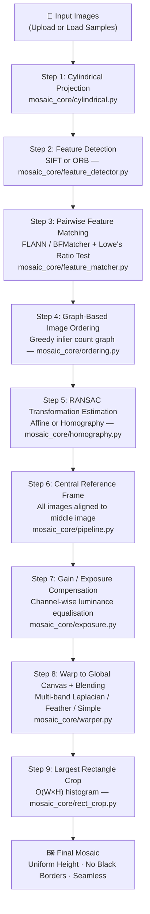

# ⟁ SYNTH-MOSAIC PRO — Full Technical Explanation
### AURA-CV Neural Spatial Studio | Complete Pipeline & UI Reference

## What is This Application?

**SYNTH-MOSAIC PRO** is a Spatial Image Fusion System — a web-based tool that takes multiple overlapping photographs (taken by rotating a camera from left to right) and automatically stitches them into a single wide, seamless, high-resolution mosaic composite.

It is built with:
- **Python** as the core language
- **OpenCV (`cv2`)** for all computer vision operations
- **NumPy** for matrix mathematics
- **Streamlit** as the interactive web UI (glassmorphism dark theme)
- **Pillow (PIL)** and **Matplotlib** for image display and visualisation

---

## 🗺️ Full Pipeline Flow — Step by Step



---

## Step 1 — Cylindrical Projection (`mosaic_core/cylindrical.py`)

> [!IMPORTANT]
> This step prevents the most common failure of naive stitching: **wedge / trapezoid distortion** where the right side of the mosaic flares outward like a horn or cone.

### What it does
When a camera rotates around its vertical axis to capture a scene, each photograph represents a different **angular slice**. Standard flat (planar) stitching maps these rotations using projective homographies, but chaining multiple homographies causes the perspective division terms ($h_{20}, h_{21}$) to compound and blow up — producing a cone-shaped "trumpet" distortion.

**Cylindrical projection** solves this by mathematically "unrolling" the camera rotation onto the surface of an imaginary cylinder. After projection, what was a **rotation** becomes a **pure horizontal translation**, which the Affine transform handles perfectly.

### The Math (Inverse Mapping)
For each output pixel $(x_{cyl}, y_{cyl})$ on the cylinder, we compute where it came from in the original flat photo:

$$\theta = \frac{x_{cyl} - c_x}{f} \quad \Rightarrow \quad x_{src} = f \cdot \tan(\theta) + c_x$$

$$y_{src} = \frac{y_{cyl} - c_y}{\cos(\theta)} + c_y$$

Where $f$ = focal length in pixels, $c_x, c_y$ = image centre. The code builds lookup maps (`map_x`, `map_y`) and uses `cv2.remap()` for fast bilinear resampling.

### Focal Length Estimation
Estimated from the assumed horizontal Field-of-View (default 60°):

$$f = \frac{W}{2 \cdot \tan(\text{FOV}/2)}$$

After warping, `strip_black_cols()` removes the black curved edges that appear at the left/right borders.

---

## Step 2 — Feature Detection (`mosaic_core/feature_detector.py`)

The app supports **two detectors**, selectable from the ◈ PARAMETER HUB sidebar:

### SIFT — Scale-Invariant Feature Transform (Default & Recommended)

SIFT works in four stages:

1. **Scale-Space Extrema Detection**: Builds a Gaussian pyramid (blurred images at multiple scales), then computes Difference-of-Gaussians (DoG) between adjacent levels. Local maxima/minima in this 3D scale-space are candidate keypoints.

2. **Keypoint Localisation**: Fits a quadratic to each candidate, refining position and scale to sub-pixel accuracy. Rejects low-contrast points and edge responses (using the Harris criterion).

3. **Orientation Assignment**: Computes gradient directions in the keypoint's local patch. Assigns the dominant orientation → makes the descriptor **rotation-invariant**.

4. **Descriptor Construction**: Samples a 16×16 patch (at the keypoint's scale), divides into 4×4 sub-blocks, computes an 8-bin gradient histogram per block → **128-dimensional float vector**.

**Why SIFT is powerful**: The 128-D descriptor is highly distinctive and invariant to scale, rotation, and moderate illumination change. It reliably finds the same physical corner/texture in photos taken from different angles.

### ORB — Oriented FAST and Rotated BRIEF (Alternative)

ORB is a fast, patent-free alternative to SIFT:

1. **FAST Corner Detector**: Checks 16 pixels on a circle around each candidate. If N consecutive pixels are all brighter or all darker than the centre by a threshold, it is a corner.

2. **Harris Score**: Ranks corners by their Harris response to retain only the strongest.

3. **Orientation**: Uses image moments in a patch to assign an orientation → rotation-invariant.

4. **BRIEF Descriptor**: Compares the intensity of random pixel pairs in a patch, encoding each comparison as a single bit → compact **256-bit binary string** (32 bytes).

**Why ORB is useful**: Much faster than SIFT, good for real-time or mobile applications. Less accurate for wide-angle stitching.

```
Feature Detector Comparison:
┌─────────────────┬────────────────┬─────────────────┐
│ Property        │ SIFT           │ ORB             │
├─────────────────┼────────────────┼─────────────────┤
│ Descriptor Type │ Float (128-D)  │ Binary (256-bit)│
│ Scale Invariant │ ✅ Yes         │ ✅ Yes          │
│ Rotation Inv.   │ ✅ Yes         │ ✅ Yes          │
│ Speed           │ Slower         │ Fast            │
│ Accuracy        │ High           │ Moderate        │
│ Best Used For   │ Quality mosaic │ Fast / real-time│
└─────────────────┴────────────────┴─────────────────┘
```

---

## Step 3 — Feature Matching (`mosaic_core/feature_matcher.py`)

After every image has keypoints + descriptors, we find which keypoints in Image A correspond to the same physical point in Image B.

### Two Matchers (chosen automatically)

**FLANN (Fast Library for Approximate Nearest Neighbours)** — used with SIFT:
- Builds a **KD-tree** index over the 128-D SIFT float descriptors
- For each descriptor in Image A, finds its **2 nearest neighbours** in Image B
- Extremely fast for large float descriptor sets

**BFMatcher (Brute-Force Matcher)** — used with ORB:
- Compares every ORB descriptor in Image A against every descriptor in Image B using **Hamming distance** (counts differing bits)
- More exhaustive but correct for small binary descriptors

### Lowe's Ratio Test
Raw matches contain many false positives. For each match, we find the **best match** ($d_1$) and **second-best match** ($d_2$) and keep the match only if:

$$\frac{d_1}{d_2} < 0.75$$

**Why**: A genuine match has a much smaller distance to its true correspondence than to any other descriptor. If the ratio is high (≈1.0), the match is likely ambiguous (e.g., a repetitive texture wall) and is discarded.

---

## Step 4 — Graph-Based Image Ordering (`mosaic_core/ordering.py`)

> [!NOTE]
> When a user uploads images in random order, the pipeline must automatically discover the correct left-to-right sequence before stitching.

After all pairs are matched, we have an inlier-count matrix used as a weighted graph:
- **Nodes** = individual images
- **Edge weights** = number of RANSAC inliers between each pair

### Greedy Chain Algorithm
1. **Seed**: Find the pair with the **highest inlier count** (most overlap) → start the chain.
2. **Grow Right**: From the rightmost image, find the unvisited image with the most matches → append.
3. **Grow Left**: Check if any unvisited image matches better to the leftmost → prepend.
4. Repeat until all images are placed.

This discovers the correct ordering regardless of upload order.

---

## Step 5 — Transformation Estimation with RANSAC (`mosaic_core/homography.py`)

For each adjacent pair in the ordered sequence, we compute the geometric transformation mapping one image's coordinate space to the other's.

### Affine / Similarity Transform (Default)
A **4-DOF similarity transform**: translation + rotation + uniform scale.

$$H = \begin{pmatrix} s\cos\theta & -s\sin\theta & t_x \\ s\sin\theta & s\cos\theta & t_y \\ 0 & 0 & 1 \end{pmatrix}$$

The key insight: the **bottom row is always [0, 0, 1]** — no perspective division ever occurs. This guarantees that parallel horizontal lines stay horizontal and image heights remain perfectly uniform across the whole mosaic.

### Full Homography (Optional)
An **8-DOF projective transform** (full 3×3 matrix). Can represent any planar mapping, but the bottom-row terms $h_{20}, h_{21}$ cause perspective shrink/stretch — leading to wedge distortion when multiple homographies are chained.

### RANSAC — Random Sample Consensus
RANSAC finds the correct transform even with many false matches (outliers):

1. **Randomly sample** the minimum matches needed (4 for homography, 3 for affine).
2. **Fit** a candidate transformation to that tiny sample.
3. **Count inliers**: how many of all matches agree (reprojection error < 4px threshold).
4. **Repeat** up to 2000 iterations.
5. **Keep** the transformation with the **most inliers** and refit using all of them.

Result: reliable estimation even when 50–70% of matches are wrong.

---

## Step 6 — Central Reference Frame (`mosaic_core/pipeline.py`)

> [!TIP]
> Instead of chaining transforms from left to right (which accumulates blur and drift), ALL images are aligned directly to the **middle image** of the sequence.

For 5 images [A, B, C, D, E] with C as reference:
- A → C: $H_{B \rightarrow A}^{-1} \cdot H_{C \rightarrow B}^{-1}$
- B → C: $H_{C \rightarrow B}^{-1}$
- C → C: Identity
- D → C: $H_{D \rightarrow C}$
- E → C: $H_{D \rightarrow C} \cdot H_{E \rightarrow D}$

The maximum chain length is halved ($N/2$ instead of $N-1$), symmetrically minimising cumulative error from both sides. No image undergoes more than $N/2$ transformation compositions, so blur and drift are minimised.

---

## Step 7 — Gain / Exposure Compensation (`mosaic_core/exposure.py`)

> [!NOTE]
> This is a new module added to SYNTH-MOSAIC PRO. It addresses visible luminance banding at image joints caused by auto-exposure differences between frames.

### `GainCompensator` — How It Works

1. **Overlap Detection**: For each pair of adjacent ordered images, their warped binary masks are intersected to find the shared pixel region.
2. **Per-Channel Statistics**: Within that overlap zone, the mean intensity is computed for each colour channel ($B, G, R$) separately.
3. **Gain Derivation**:
   $$g_{i,c} = g_{i-1,c} \times \frac{\bar{I}_{i-1,c}}{\bar{I}_{i,c}}$$
   The first image receives unity gain ($g_0 = [1, 1, 1]$). Each subsequent image is normalised relative to its left neighbour.
4. **Application**:
   $$\text{out}_{i} = \text{clip}(\text{img}_i \times g_{i}, 0, 255)$$

### Effect
- Sky gradients across image joins become continuous.
- Architectural surfaces and water reflections show no sudden brightness steps.
- The compensated images are passed to the blending step — the multi-band Laplacian then further smooths any residual seams at high frequencies.

The toggle `compensate_exposure` in the ◈ PARAMETER HUB sidebar enables/disables this stage.

---

## Step 8 — Warping and Blending (`mosaic_core/warper.py`)

### Warping to Global Canvas
1. Each image's 4 corners are transformed by its $H_{to\_ref}$ matrix (`cv2.perspectiveTransform()`) to find where it lands in reference coordinates.
2. The bounding box of all transformed corners defines the **global canvas** size.
3. A translation matrix $T$ shifts coordinates so the canvas top-left is at origin (0,0).
4. Each image is warped onto the canvas: `cv2.warpPerspective(img, T @ H_to_ref, canvas_size)`.

### Three Blending Modes

**1. Multi-band Laplacian Pyramid Blending (Default)**
The most sophisticated blending — blends low-frequency (colour/illumination) and high-frequency (edges/texture) content separately:

1. Build a **Gaussian pyramid** (blurred/downsampled versions) for each image and the alpha weight mask.
2. Build a **Laplacian pyramid**: $L_k = G_k - \text{upsample}(G_{k+1})$. Each level captures details at that frequency band.
3. **Blend each pyramid level** separately using the alpha mask (smooth, from distance transform).
4. **Reconstruct** by summing back up the pyramid.

Result: **no visible seams**, even with illumination differences, because low-frequency colour is blended over a wide boundary while sharp edges are preserved over a narrow one.

**2. Feather / Distance-Transform Blending**
Each pixel in the overlap zone gets a weight equal to its **distance to the nearest image boundary**:

$$\alpha_A(x,y) = \frac{d_A(x,y)}{d_A(x,y) + d_B(x,y)}$$

Produces smooth, gradual cross-dissolves across overlapping regions.

**3. Simple Overlay**
No blending — each new image just overwrites the previous one. Fast but produces visible seams at boundaries.

---

## Step 9 — Automatic Rectangle Crop (`mosaic_core/rect_crop.py`)

After blending, the canvas has black (zero) regions wherever no image contributed — irregular curved borders from cylindrical warping and slight rotations.

### O(W×H) Histogram Algorithm
1. For each **row** of the binary validity mask, build a **column-height histogram**: for each column, how many consecutive valid rows exist above?
2. Apply the **Largest Rectangle in Histogram** (classic stack-based O(n) algorithm) to find the widest rectangle fitting in that row.
3. Track the globally largest such rectangle across all rows.

This finds the **largest possible axis-aligned rectangle** contained entirely within valid pixels — guaranteeing no black edges or borders in the final output.

---

## Streamlit UI Features (`app.py`) — SYNTH-MOSAIC PRO Interface

The app is styled with a custom **glassmorphism dark theme** (deep navy background, neon accent lines, blurred card surfaces). It is branded as **SYNTH-MOSAIC PRO | AURA-CV Neural Spatial Studio**.

### ◈ PARAMETER HUB Sidebar

| Control | Description |
|:--------|:------------|
| **Stitching Engine** | Switch between Custom Pipeline (full SIFT/ORB + telemetry) or OpenCV Native (`cv2.Stitcher`) |
| **Cylindrical Projection** | Toggle cylindrical warping on/off |
| **Horizontal FOV** | Camera lens FOV in degrees (affects focal length) |
| **Transform Model** | Affine/Rigid (distortion-free) or Full Homography |
| **Canvas Crop Mode** | Largest interior rectangle or no crop |
| **Feature Detector** | SIFT or ORB |
| **Max Features** | Maximum keypoints to detect per image |
| **Lowe's Ratio** | Ratio test threshold (0.65–0.85) |
| **RANSAC Threshold** | Reprojection error tolerance in pixels |
| **Blend Mode** | Multi-band Laplacian / Feather / Simple overlay |
| **Exposure Compensation** | Toggle channel-wise gain normalisation |
| **Before vs After** | Generate naive cv2.Stitcher output for comparison |

### Sample Loaders
- **◈ Load Field Captures**: Loads images from `field_captures/` (benchmark dataset).
- **◈ Load Synthetic Quads**: Loads images from `synthetic_quads/` (synthetic test strips).
- **Custom Upload**: Drag-and-drop any overlapping JPG/PNG/TIFF/BMP photos.

### 5 Analysis Tabs

| Tab | Contents |
|:----|:---------|
| **◈ Composite Viewport** | Full-resolution mosaic preview; aspect ratio and resolution metrics; PNG/JPEG download buttons |
| **⟁ Manifold Rectification & Distortion Audit** | Side-by-side Before (naive homography) vs After (corrected mosaic) with annotation labels |
| **◈ Keypoint Topology** | Pairwise feature match images with coloured correspondence lines; global RANSAC inlier heatmap matrix |
| **⟳ Iterative Mosaic Timeline** | Step-by-step view of canvas as each image is progressively added |
| **▲ Executive Telemetry** | Latency bar chart per pipeline stage; total keypoints; average inlier count; throughput statistics |

### Live Progress
- Step-by-step progress bar with percentage and status messages updates during pipeline execution.

---

## Complete File Map

```
CrimeScenceDetecion/
├── app.py                    ← Streamlit UI (SYNTH-MOSAIC PRO, glassmorphism theme, 5 tabs)
├── run_test.py               ← Headless CLI test runner (no browser required)
├── requirements.txt          ← Python dependencies
├── run.sh                    ← One-command startup script
├── README.md                 ← Project overview & quick start
├── DOCUMENTATION.md          ← Full engineering & mathematical reference
├── app_explanation.md        ← This file — complete pipeline walkthrough
├── field_captures/           ← Benchmark dataset (real-world scene photos)
├── synthetic_quads/          ← Synthetic test image strips
├── render_cache/             ← Intermediate render cache (gitignored)
├── output_artifacts/         ← CLI test run outputs (gitignored)
└── mosaic_core/              ← Core spatial mosaic computer vision library
    ├── __init__.py           ← Package namespace & GainCompensator export
    ├── pipeline.py           ← Orchestrates all 9 steps; returns StitchResult
    ├── exposure.py           ← GainCompensator: channel-wise luminance equalisation
    ├── cylindrical.py        ← Cylindrical warping math & FOV focal length estimator
    ├── feature_detector.py   ← SIFT / ORB detection wrapper
    ├── feature_matcher.py    ← FLANN / BFMatcher + Lowe's ratio test
    ├── homography.py         ← RANSAC Affine / Homography estimation
    ├── ordering.py           ← Graph-based sequence optimizer
    ├── warper.py             ← Warp to canvas + 3 blend modes + exposure compensation
    ├── rect_crop.py          ← Largest interior rectangle crop (O(W×H))
    └── utils.py              ← Image I/O helpers & thumbnail utilities
```

---

## Why Does the Final Mosaic Look So Good?

| Problem | Solution Used |
|:--------|:-------------|
| Wedge / trapezoid distortion | Cylindrical projection + Affine transform (not full homography) |
| Blurry / drifted panorama | Central reference frame — all images aligned to the middle one |
| Wrong photo order | Graph-based inlier-count ordering (`mosaic_core/ordering.py`) |
| Exposure banding at joins | Channel-wise gain compensation (`mosaic_core/exposure.py`) |
| Visible seams at joins | Multi-band Laplacian pyramid blending (`mosaic_core/warper.py`) |
| Black borders around mosaic | O(W×H) largest-rectangle crop algorithm (`mosaic_core/rect_crop.py`) |
| False feature matches | Lowe's ratio test + RANSAC outlier rejection |
| No benchmark reference | Before vs After comparison tab (naive cv2.Stitcher vs SYNTH-MOSAIC PRO) |
| No performance visibility | Executive Telemetry tab with per-stage latency breakdown |
